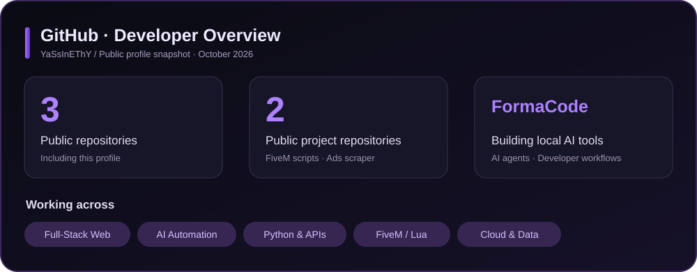
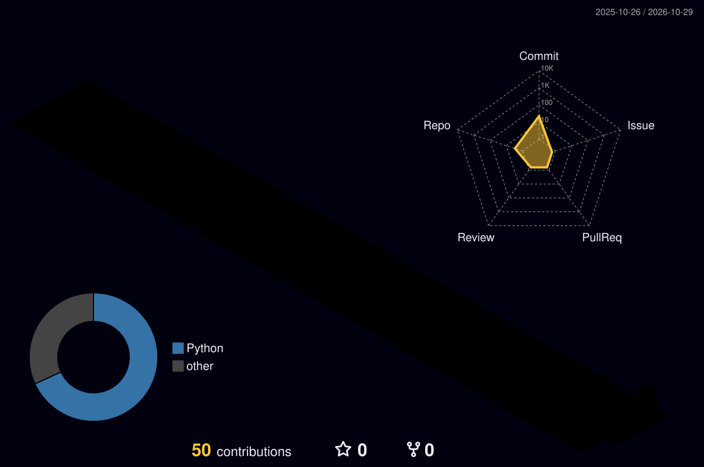

<!-- GitHub profile: YaSsInEThY -->

---

### 👨‍💻 About me

I'm a **developer and MIAGE student based in Tangier, Morocco**. I build practical applications with a strong interest in **AI-powered developer tools, full-stack web applications, cloud services, automation, and FiveM development**.

- 🚀 Building **FormaCode** — a local AI-powered assistant for coding and creative workflows.
- 🛠️ Developing websites, developer utilities, APIs, automation tools, and FiveM resources.
- 🧠 Exploring local AI inference, AI agents, and reliable tool-using workflows.
- 🌍 Open to meaningful development collaborations and interesting technical challenges.

### 🎯 Focus areas

`Full-Stack Development` · `AI Agents & Local AI` · `Automation` · `FiveM / Qbox` · `Cloud & APIs` · `Databases` · `UI/UX`

### 🧰 Languages and tools

### 🚀 Selected projects

| Project | What I'm building |
|:---|:---|
| [**Evot-Q Ads Scraper**](https://github.com/YaSsInEThY/evotq-ads-scraper) | Python tooling for advertising data collection and processing. |
| [**FiveM Scripts**](https://github.com/YaSsInEThY/fivem-script) | A public workspace for FiveM-related scripting. |
| **FormaCode** | Work-in-progress local AI assistant project; source isn't publicly linked here. |

### 📊 GitHub activity

<!-- Automatically generated by .github/workflows/metrics.yml on successful run. -->

  

### 🏙️ 3D contribution calendar

<!-- Automatically generated by .github/workflows/profile-3d.yml on successful run. -->

  

---

  Building practical software, one project at a time · Tangier, Morocco 🇲🇦

